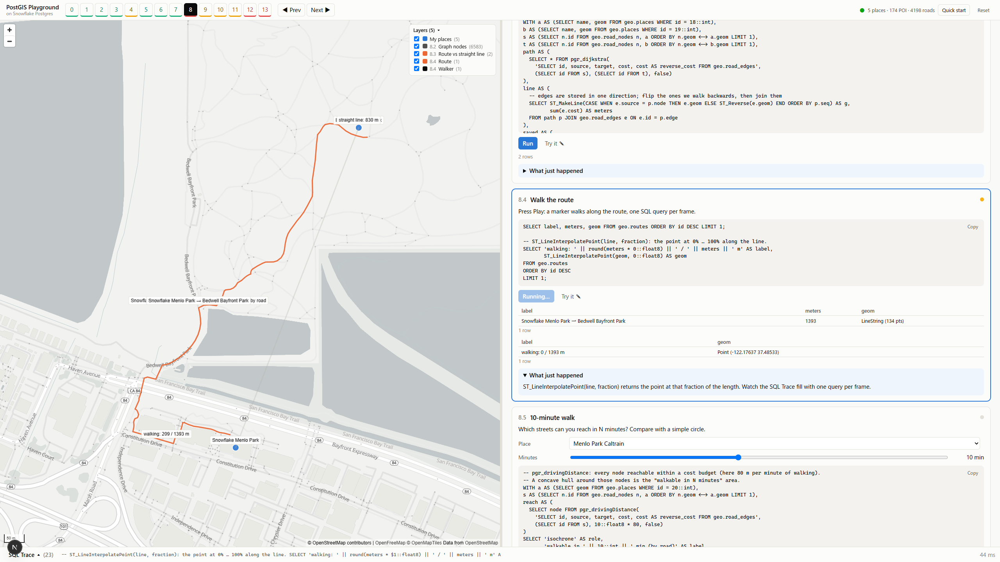
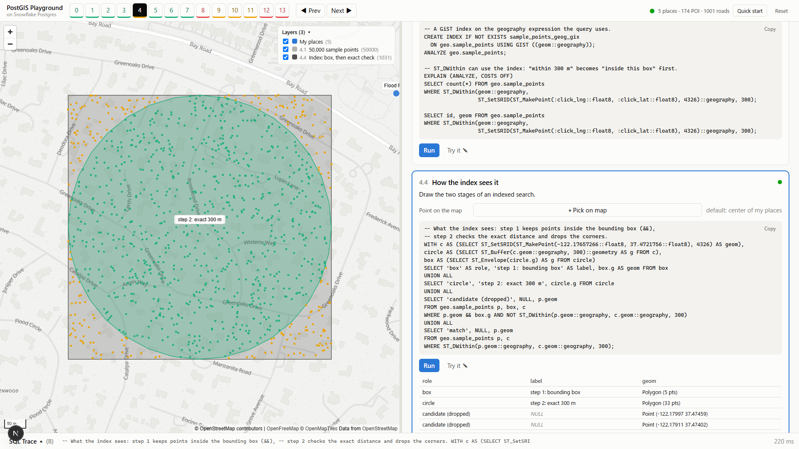
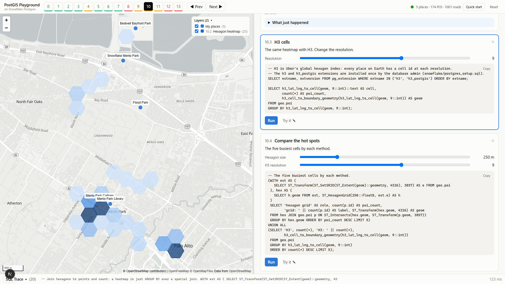

# PostGIS Playground

**Build a PostGIS learning app in minutes with Snowflake App Runtime — then use it to learn GIS, one SQL query at a time.**

PostGIS Playground is a web app that teaches spatial SQL step by step. Half the screen is a map; the other half is a lesson.
Every step shows the exact SQL it runs, you press **Run**, and the result is drawn on the map — points drop in,
routes grow along the streets, heatmaps fade in. Nothing happens on the map that you cannot read as SQL.

It runs on **Snowflake App Runtime** (a Next.js app deployed with one command) and uses **Snowflake Postgres** with PostGIS.
You can study with a sample neighborhood around Snowflake's Menlo Park office, or type in places you know —
the app geocodes them and downloads the streets, parks and shops around them from OpenStreetMap.
The sample region itself is one config file, so a workshop can start in any city.



## What you learn

14 lessons, 4–5 steps each. Basic lessons cover what most map features need; the rest go deeper.

| # | Lesson | Level | You will use |
|---|---|---|---|
| 0 | Set up the lab | Basic | `CREATE EXTENSION postgis`, geometry columns, SRIDs |
| 1 | Your first point | Basic | `ST_MakePoint`, WKT / GeoJSON / WKB, the lat/lng swap |
| 2 | Bring in your neighborhood | Basic | geocoding, `ST_GeomFromGeoJSON`, importing OpenStreetMap JSON with SQL, `ST_IsValid` / `ST_MakeValid` |
| 3 | How far is it? | Basic | geometry vs geography, distance matrix, great circles |
| 4 | Make it fast | Intermediate | GiST indexes, `ST_DWithin`, reading `EXPLAIN ANALYZE` |
| 5 | Within reach | Basic | `ST_Buffer`, `ST_Intersection`, `ST_Union` |
| 6 | What's nearest? | Basic | KNN `<->`, `LATERAL`, `ST_ShortestLine`, Voronoi diagrams |
| 7 | Shapes and areas | Basic | `ST_Area`, point-in-polygon, spatial predicates, spatial joins |
| 8 | Lines and routes | Advanced | building a street graph with SQL, `pgr_dijkstra`, `ST_LineInterpolatePoint`, isochrones |
| 9 | Summarize space | Intermediate | centroids, convex / concave hulls, `ST_ClusterDBSCAN`, `ST_Simplify` |
| 10 | Grids and heatmaps | Intermediate | `ST_SquareGrid`, `ST_HexagonGrid`, H3 |
| 11 | Projections | Intermediate | `ST_Transform`, UTM, why Web Mercator lies about size |
| 12 | Draw the map with SQL | Advanced | `ST_TileEnvelope`, `ST_AsMVT` — the map's own tiles served by PostGIS |
| 13 | Take it to Snowflake (bonus) | Advanced | the same questions with Snowflake `GEOGRAPHY` and H3 functions |

| | |
|---|---|
|  |  |
| Lesson 4 — how a spatial index filters by boxes first | Lesson 10 — a hexagon heatmap of points of interest |

## How it works

```
Browser (MapLibre GL)  ──HTTPS──▶  Next.js on Snowflake App Runtime  ──5432──▶  Snowflake Postgres + PostGIS
                                         │                                       (pgRouting, H3)
                                         └──HTTPS──▶  OpenStreetMap Nominatim / Overpass (Lesson 2)
```

- **One source of SQL.** Each lesson's SQL lives in [`sql/lessons/`](sql/lessons). The text shown in the app is the text that runs.
- **SQL Trace.** The bar at the bottom lists every statement (with its bind parameters) and every HTTP call the app made.
- **Anything with a geometry column is drawn.** Columns become feature properties, so the SQL decides labels and colors.
  The "Try it" editor works the same way: write your own query and see it on the map.
- **Safe by default.** Values from the page are always bind parameters; the app connects as Postgres's
  non-admin `application` role.

## Get started with Cortex Code (recommended)

This repository ships two skills for **Cortex Code (CoCo Desktop / CLI)** in
[`.snowflake/cortex/skills/`](.snowflake/cortex/skills):

| Skill | What it does |
|---|---|
| `postgis-playground-setup` | Creates (or reuses) the Snowflake Postgres instance, sets up its network policy, installs PostGIS / pgRouting / H3, creates the secret and external access integration, fills in `app.yml`, and deploys. |
| `postgis-playground-region` | Switches the sample region from Menlo Park to your city: edits `config/region.json`, downloads the OpenStreetMap data, and redeploys. |

1. Clone this repository and open the folder in CoCo Desktop (project skills are picked up automatically;
   in the CoCo CLI use `/skill add .snowflake/cortex/skills/postgis-playground-setup`).
2. Ask: **"Set up and deploy this app."**
3. Optional: **"Change the sample region to my city: …"**

CoCo asks before it creates anything that costs money, and never writes passwords into files.

## Get started by hand

1. **Snowflake Postgres** — create an instance and allow connections: [docs/01-snowflake-postgres.md](docs/01-snowflake-postgres.md)
2. **External access** — let the app reach Postgres and OpenStreetMap: [docs/02-external-access.md](docs/02-external-access.md)
3. **Deploy** — fill in `app.yml` and run `snow app deploy`: [docs/03-deploy.md](docs/03-deploy.md)
4. Open the app, press **Quick start** (or go through Lessons 0–2), and learn.

Bonus: [docs/04-snowflake-bonus.md](docs/04-snowflake-bonus.md) connects Lesson 13 to Snowflake.

Requirements: a paid Snowflake account with Snowflake Postgres and App Runtime available, ACCOUNTADMIN (or equivalent)
for the one-time setup, Snowflake CLI with App Runtime support (`snow helpers check-version`), Node.js 22+ for local development.

## Use your own city

Edit [`config/region.json`](config/region.json) — a name, an anchor point, and 2–5 places — then:

```bash
npm run seed:build    # geocodes the places and downloads their OpenStreetMap data into data/seed/sample.json
snow app deploy       # then press Reset → Quick start in the app
```

The map opens there, Lesson 1 starts at your anchor point, and every lesson uses your neighborhood.
See [`config/examples/`](config/examples) for a Tokyo example. Learners can also type their own places in Lesson 2 at any time.

## Run locally

```bash
cp .env.example .env.local      # fill in PGHOST, PGUSER, PGPASSWORD (your IP must be in the Postgres network rule)
npm install
npm run dev                      # http://localhost:3000
node scripts/smoke.mjs http://localhost:3000   # runs every lesson step once
```

Add `?present=1` to the URL for a large-font presentation mode. Keyboard: `←` `→` change lessons, `↑` `↓` move between steps.

## Project layout

```
app.yml                 App Runtime manifest
sql/common.sql          data import, option lists, the vector tile query
sql/lessons/*.sql       one file per lesson; "-- name: block" sections
src/lessons/index.ts    lesson text, controls, and how each result is drawn
src/server/             Postgres access, SQL trace, parameter validation, OpenStreetMap import
src/components/         map, lesson steps, controls, SQL Trace
snowflake/              setup SQL for Snowflake and for Postgres
config/region.json      the sample region (name, anchor point, places)
data/seed/sample.json   offline OpenStreetMap snapshot of the sample region (ODbL)
scripts/                seed builder, Postgres setup without psql, smoke test
.snowflake/cortex/skills/  Cortex Code skills: setup + deploy, switch region
```

## Data and attribution

Map data © [OpenStreetMap contributors](https://www.openstreetmap.org/copyright), available under the
Open Database License (ODbL). The basemap is [OpenFreeMap](https://openfreemap.org). Geocoding uses
[Nominatim](https://nominatim.org) and data downloads use the [Overpass API](https://overpass-api.de) —
both are free community services with usage policies: the app identifies itself, waits a second between
geocoding requests, caches every response, and keeps downloads small. Please keep it that way.

## License

Code: [Apache License 2.0](LICENSE). Map data in `data/seed/`: © OpenStreetMap contributors, ODbL 1.0 (see [NOTICE](NOTICE)).
